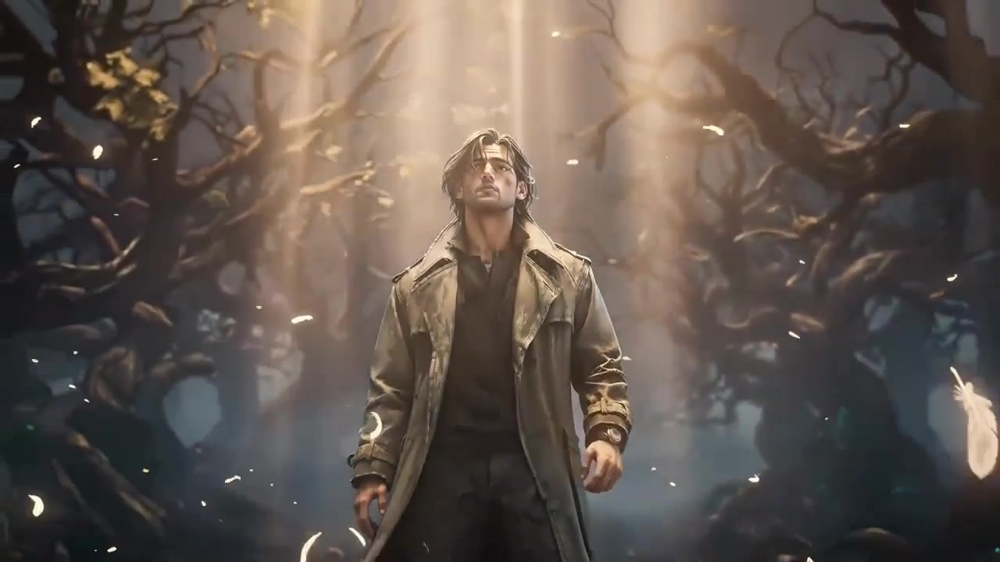
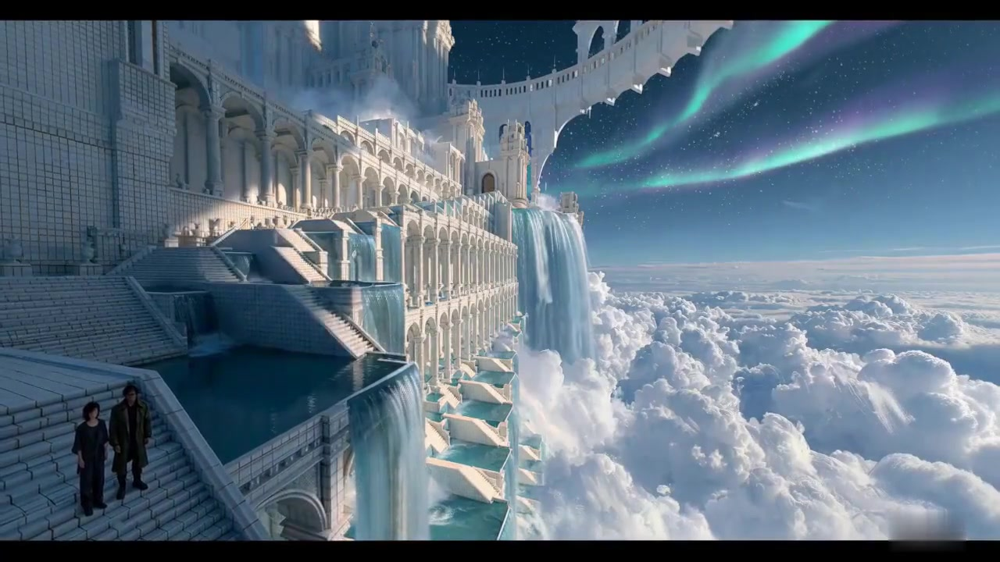
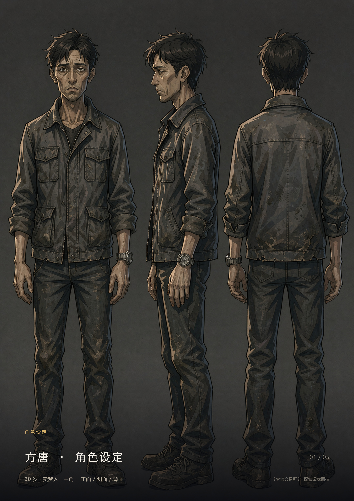
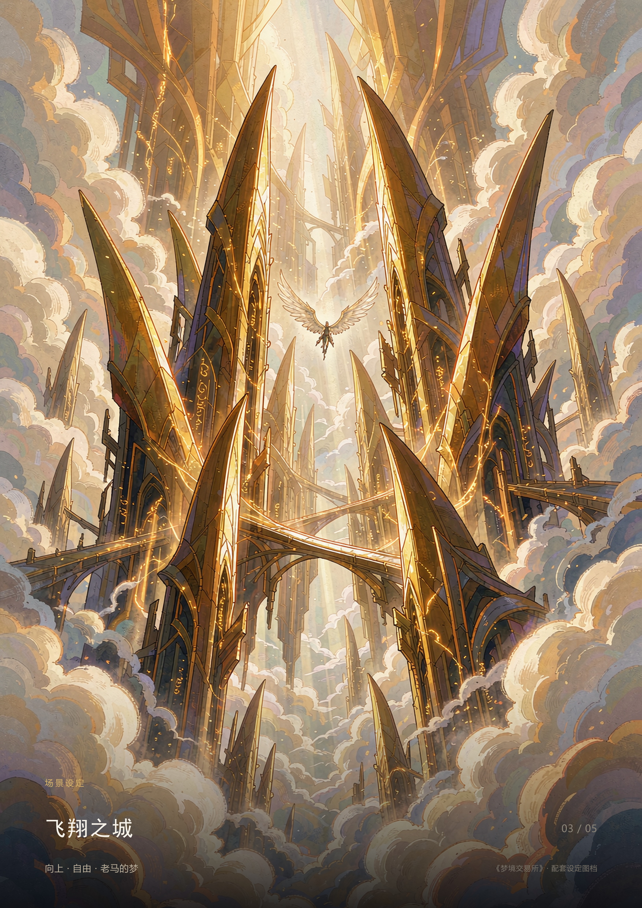

# 《梦境交易所》AIGC创作实践

AI视频与漫剧方向的个人求职作品展示。基于赛事限定故事梗概，借助大模型拓展剧本与视觉方案，个人推进提示词调整、生成素材筛选与镜头尝试。目标片花90至120秒，最终叙事成片仍在制作中。

## 先看30秒视频

**[百度网盘观看／下载《梦境交易所》30秒素材展示](https://pan.baidu.com/s/1MVeq3yMEtL9qiM9T-nAeDQ?pwd=7ri5)**

提取码：**7ri5**。视频为现有片段整理的求职展示短片，非最终叙事片花，图像和视频素材由AI辅助生成。

备用：[GitHub中的视频文件](demo/30s-showcase.mp4)。

## 画面截图

## 制作实践

- 视觉选择：围绕三渲二风格筛选角色与场景，用提示词约束人物质感，淘汰过度光滑、风格不符的候选结果。
- 镜头迭代：关注人物视线、动作朝向和镜头衔接，尝试修改提示词与切镜方案。
- 声音与剪辑：尝试AI配音，关注语气词与情绪表达；可使用剪映处理拼接、字幕、配乐与音量。
- 工具：ChatGPT、WorkBuddy、TapNow、即梦、Midjourney相关提示词工具、剪映。

## 设定参考

提示词与结果取舍示例见 [制作说明](docs/process.md)。现有设定图与视频来自不同探索阶段，不承诺所有候选素材均已完成跨镜风格统一。

故事概念来自赛事限定梗概；展示内容不声明获奖、商业交付或独立原创故事。素材仅作个人求职展示，第三方素材及工具相关权利归其权利人。
